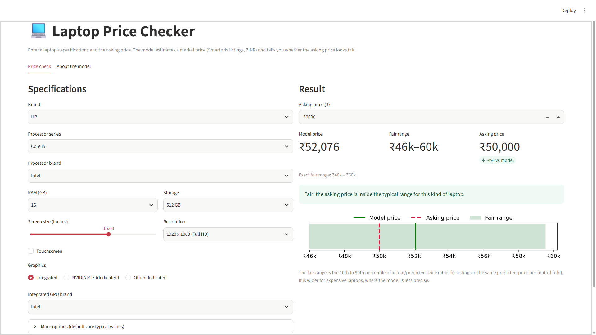
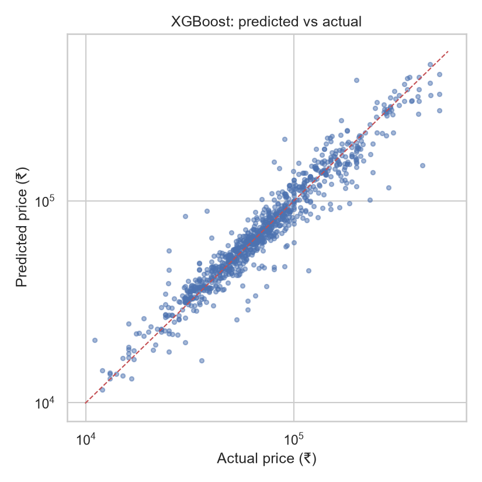
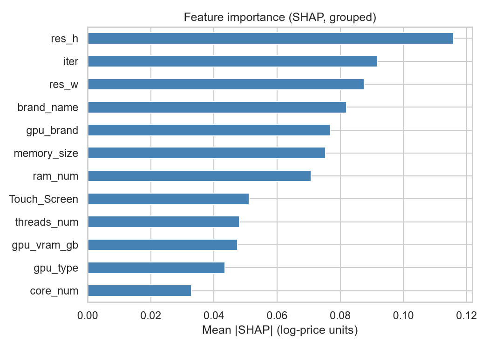

# Laptop Fair Price Check

Predict a laptop's market price from its specs, then check whether an asking price looks fair.
Built on 940 laptop listings from Smartprix (prices in ₹), with a Streamlit app on top.

**Live demo:** _add your Streamlit link here after deploying_

<!-- Add a screenshot or GIF of the app: save it as docs/app_screenshot.png and uncomment the line below -->
<!--  -->

## What it does

1. Predicts log price from 20 spec features with XGBoost (a Ridge baseline and a Random Forest for comparison).
2. Explains the model with SHAP.
3. Compares an asking price with the model price using a **data-driven fair range**: the 10th to 90th percentile of actual/predicted price ratios among listings in the same predicted-price tier. The range is wider for expensive laptops, where the model is less precise.

## Results

5-fold cross-validation, grouped by laptop model name so the same laptop never appears in both train and test.

| Model | R² (log price) | MAE (₹) | Median % error |
|---|---|---|---|
| Ridge (baseline) | 0.897 | 15,123 | 9.8% |
| Random Forest | 0.903 | 13,354 | 9.0% |
| **XGBoost** | **0.922** | **12,036** | **8.5%** |

XGBoost's MAE is about 20% lower than the baseline's. With 940 rows, the small gap between Random Forest and XGBoost should be treated cautiously.

**Error by price quarter (XGBoost)**

| Price range | Median % error | MAE (₹) |
|---|---|---|
| ₹10,990 – ₹45,490 | 8.9% | 4,206 |
| ₹45,800 – ₹66,990 | 7.1% | 5,196 |
| ₹66,999 – ₹99,990 | 7.0% | 9,546 |
| ₹99,999 – ₹500,990 | 12.0% | 29,214 |

The model is least precise for the most expensive laptops.

**Fair range by predicted-price tier** (actual price as a share of the model price)

| Predicted price tier | 10th percentile | 90th percentile |
|---|---|---|
| Cheapest quarter (from ₹11.5k) | 0.85 | 1.19 |
| Second (from ₹45.9k) | 0.88 | 1.14 |
| Third (from ₹66.0k) | 0.86 | 1.21 |
| Priciest (from ₹104.2k) | 0.79 | 1.26 |

The ranges are calibrated on the same listings, so on genuinely new laptops fewer than 80% may fall inside them.



## What drives price (SHAP)

- Screen resolution ranks first, followed by CPU series, brand, GPU brand, storage and RAM.
- Very small storage pulls the prediction down hard; the highest resolutions push it up by up to roughly 50%.
- GPU features overlap (VRAM and GPU model number correlate at 0.92), so SHAP splits the credit between them.
- Touchscreen laptops are 11% of the listings and have a much higher median price (₹127,990 vs ₹63,289). Treat this as a marker of higher-end models, not a causal effect.
- SHAP explains what the model uses, not what causes prices.



## Data and cleaning

- Source: the Smartprix laptop specifications and prices dataset on Kaggle
  (https://www.kaggle.com/datasets/anshsahu111/laptop-specifications-and-prices-dataset). Check the dataset page for its license terms.
- 1,018 rows in the cleaned file; 78 repeated listings removed, leaving 940.
- Fixed swapped resolution columns, extracted GPU model and VRAM from the raw text, grouped rare categories, and used log price as the target.
- `rating` was dropped (no relationship with price).

## Limitations

- Prices are listing prices from one site at one point in time, not final sale prices.
- The model knows nothing about condition, age or seller, so it does not apply to used or refurbished laptops.
- It is least precise for the most expensive laptops.
- The verdict is a guide, not a guarantee.

## Run it locally

```bash
conda create -n laptop python=3.11 -y
conda activate laptop
pip install -r requirements.txt
streamlit run app/app.py
```

To re-run the analysis, also install the notebook packages (`pip install shap seaborn ipykernel`),
run `python src/clean.py`, then the notebooks in order:

1. `notebooks/01_eda.ipynb` – exploration
2. `notebooks/02_models.ipynb` – baseline vs XGBoost, error by price band
3. `notebooks/03_explain.ipynb` – SHAP, fair price check, saves `models/`

## Project structure

```
├── app/app.py              Streamlit app
├── data/                   raw and cleaned data
├── models/                 saved model and metadata
├── notebooks/              EDA, modelling, explainability
├── reports/figures/        charts used in this README
├── src/clean.py            data cleaning
├── src/predict.py          feature building and fair price check
└── requirements.txt
```
